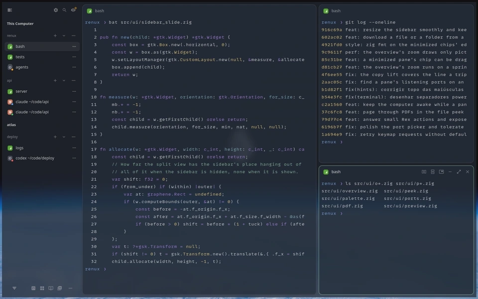

<p align="center"></p>

# Renux

A native Linux client for [Rex](https://rex.superlogical.com), written in Zig with GTK4 and
libadwaita. It shows a Rex server's sessions, windows and panes, with live terminals drawn
through libghostty-vt.

Renux is an independent project, not made by the Rex team. It is early, so expect rough edges,
and please report them as [issues](https://github.com/zenodea/renux/issues).

[](docs/screenshots/demo.mp4)

## What it does

- **Your Rex sessions, as they are.** Sessions, tabs, panes and key bindings come from the Rex
  server, so they match the Rex app and your phone.
- **Fast terminals.** Drawn with libghostty-vt, with selection, find, links, and your own font
  and theme.
- **Keyboard copying.** [Copy mode](docs/copy-mode.md) holds the scrollback still while you
  search and select with Vim keys.
- **Every tab at once.** The overview zooms out to a live grid of all your tabs, with a dot for
  each agent's state.
- **Room for your panes.** Resize the sidebar, or turn off the window background so panes float
  as cards over your desktop.
- **Your agents at a glance.** Panes show what their coding agent is doing, and the agent board
  sorts them by state. Renux can [keep the computer awake](docs/keep-awake.md) while they work.
- **Files for remote panes.** Drop or paste files into a remote pane: Rex uploads them and types
  their paths. See [file transfers](docs/file-transfers.md).
- **Peek at files.** Ctrl+click a file path to preview it, local or remote: code, pictures or
  PDFs. See [file previews](docs/file-preview.md).
- **Download from a remote pane.** Copy a remote file or folder to your Downloads folder
  straight from its peek.
- **Remote development links.** Ctrl+click a `localhost` link in a remote pane and Renux forwards
  the port and opens it in your browser. See [port forwarding](docs/port-forwarding.md).
- **Several servers.** Connect to Rex on this computer, over Tailscale, or through SSH. See
  [SSH hosts](docs/ssh-hosts.md).
- **Made to look at.** Themes, a see-through window with your desktop's blur, and ten GLSL
  shaders, from a CRT to a cursor that smears as it moves.

| Agent Board | Overview |
|---|---|
|  |  |

| Shaders | No window background |
|---|---|
|  |  |

## Installing

You need a Rex server to connect to.

### NixOS

Add Renux to the inputs in your system flake:

```nix
inputs.renux.url = "github:zenodea/renux";
inputs.renux.inputs.nixpkgs.follows = "nixpkgs";
```

Add `renux` to the arguments of `outputs`. Append this module to your host's `nixosSystem.modules` list:

```nix
({ pkgs, ... }: {
  environment.systemPackages = [ renux.packages.${pkgs.stdenv.hostPlatform.system}.default ];
})
```

Rebuild your system as usual. The package installs the `renux` command and a desktop entry.

### Other Linux distributions

1. Install Zig 0.17 and the libraries, with their development files:

   | Distribution | Command |
   |---|---|
   | Fedora | `sudo dnf install gtk4-devel libadwaita-devel librsvg2-devel poppler-glib-devel` |
   | Debian, Ubuntu | `sudo apt install libgtk-4-dev libadwaita-1-dev librsvg2-dev libpoppler-glib-dev` |
   | Arch Linux | `sudo pacman -S gtk4 libadwaita librsvg poppler-glib` |

2. Build and install into `~/.local`, which puts the program, its desktop entry and its icon
   where your desktop looks for them:

   ```sh
   git clone --recurse-submodules https://github.com/zenodea/renux
   cd renux
   zig build -Doptimize=ReleaseFast -p ~/.local
   ```

3. Start Renux from your applications menu, or run `renux`. With Rex installed on this
   computer, it connects to the Rex server here, and starts it if it isn't running. Otherwise
   it asks for your Rex server's address.

`renux --toggle` shows or hides the running window, for a desktop shortcut.
Settings are kept in `~/.config/renux`.

## Keys

Key bindings come from your Rex config, so the keys you know work here. Renux adds an action
of its own to bind there:

```lua
rex.bind("ctrl+a>shift+o", "client.overview.toggle") -- every tab at once
```

The overview and the agent board are off until you switch them on in Settings, under
Developer. The overview is in the command palette too, and has a button at the foot of the
sidebar.
In the overview, the arrow keys or `h` `j` `k` `l` move between tabs, Enter goes to one and
Escape goes back. `x` closes the tab the ring is on, `c` opens a new tab in its session and
goes to it, and `s` groups the tabs by session.

The command palette also offers **Mute or unmute tab**, **Switch host**, **Remove host…**,
and **Refresh sessions**, plus clipboard and pane-management commands. Muting silences a
tab's notifications, activity sounds and launcher badge for this run, without hiding its
activity. Removing a host asks first and leaves its sessions running. See
[the action audit](docs/action-coverage.md) for coverage and platform differences.

**Close Session…** asks for confirmation before ending every program in the current session.

### Copy mode

**Ctrl+Shift+Space** enters copy mode in the focused pane (**Shift+Command+C** on macOS).
The mode chip shows the cursor's row and column, selection kind, and any search being typed.
The entry shortcut can be changed in Settings > Shortcuts, or bound in your Rex config:

```lua
rex.bind("ctrl+a>[", "pane.copy_mode.enter")
```

- Move with `h j k l` or the arrows; `w b e` move by word, `W B E` by whitespace-separated word.
  `0 ^ $` and Home/End move within the logical line; `H M L` within the visible screen.
- `Ctrl+U/D` move half a screen, `Ctrl+B/F` or Page Up/Down a full screen. `g/G` jump to the
  top/bottom of the scrollback; `{` and `}` move between paragraphs. Type a count first to
  repeat a motion (`12k`), or choose a line (`12G`).
- `v` selects characters, `V` whole lines, `Ctrl+V` a rectangle; the same key ends that kind
  of selection. `o` swaps its ends.
- `/` or `?` opens a forward/backward literal search; Enter searches, `n/N` repeat/reverse it.
  `f F t T` find a character in the logical line; `;` and `,` repeat/reverse that find.
- `y` or Enter copies the selection and leaves. `D` copies to the end of the logical line.
  Escape or `q` leaves without copying and restores the original viewport.

Wide characters are one cursor stop, wrapped rows remain one logical line, and copying uses
exactly the same text formatter as mouse selection. [Copy-mode details and actions](docs/copy-mode.md).

A remote host answers to its own Rex config. For the same keys everywhere, turn on
Settings > Remote Hosts > Use this computer's keys on remote hosts.

Ctrl+click remote links to `localhost`, `127.0.0.1`, `[::1]` or `0.0.0.0` with an explicit
port to forward and open them. Bind `client.host.forward_port` in your Rex config, or choose
**Forward Port…** in Commands, to discover ports, enter a target, or close a forward.
Forwards listen only on `127.0.0.1` and close when this Renux window quits or the host is removed.
See [port forwarding](docs/port-forwarding.md) for requirements and limitations.

## Building

You need Zig 0.17, GTK 4, libadwaita, librsvg and poppler-glib, with their development files.
On x86-64 or ARM64 Linux with Nix flakes enabled, run `nix develop` in the checkout to get these dependencies.

```sh
git submodule update --init
zig build -Doptimize=ReleaseFast
zig build test
```

The program is `zig-out/bin/renux`. Add `-Ddev` for the development hooks: screenshots, the
test script and the frame log.

`zig build test-upload` checks file uploads against a disposable local Rex server. It needs
`rex` (API revision 11 or newer) and Python 3; it does not use your running sessions.
`zig build test-clipboard` also exercises the GTK paste handler on a private display, including
images and Ctrl+V; it additionally needs `gtk4-broadwayd` and never changes your clipboard.
`zig build test-preview` uses the same isolated setup to check downloads and preview dialogs.
`zig build test-fetch` downloads a folder and a large file from it and compares every byte.
`zig build test-forward` checks TCP forwarding, URL rewriting, reuse and cleanup against a
private Rex server and HTTP target. It needs `rex`, `curl` and Python 3, but no display.

## License

Apache 2.0; see `LICENSE`. Bundled fonts and icons keep their own licenses, noted beside them.
